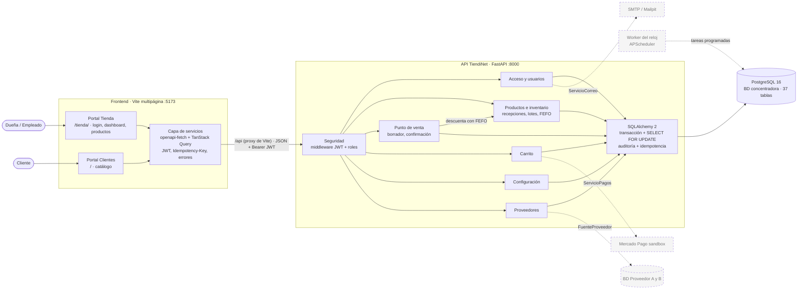
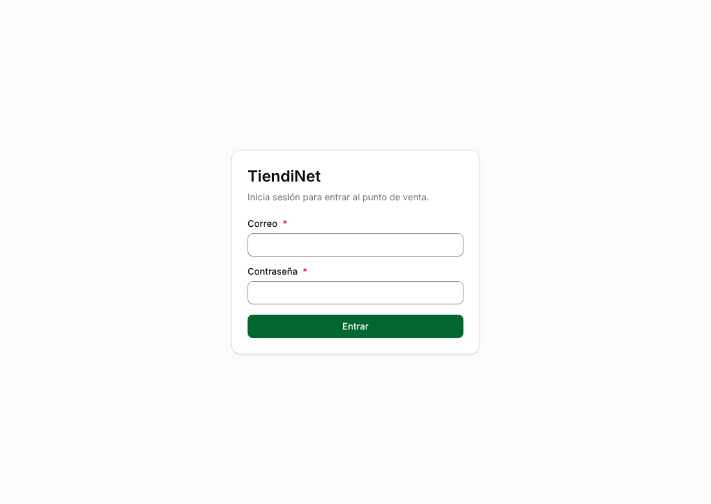
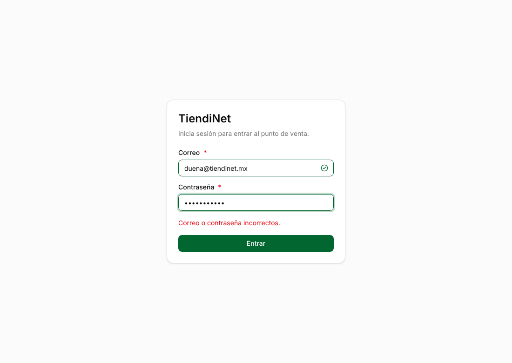
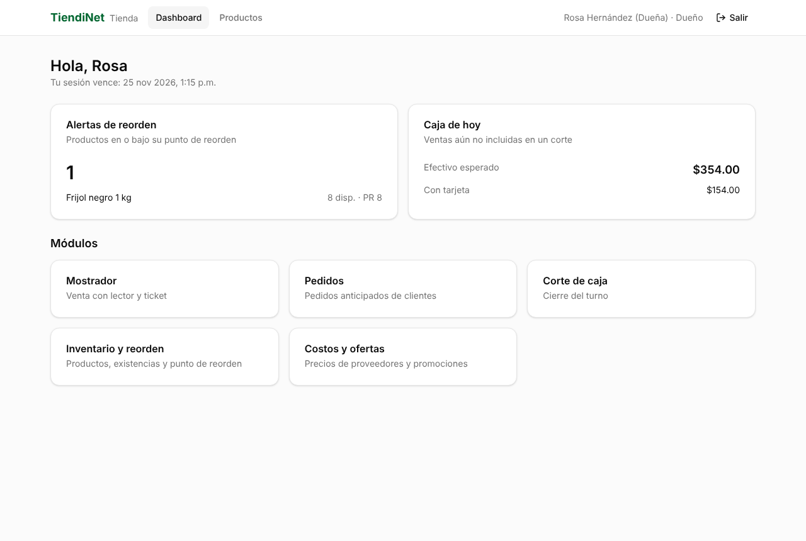
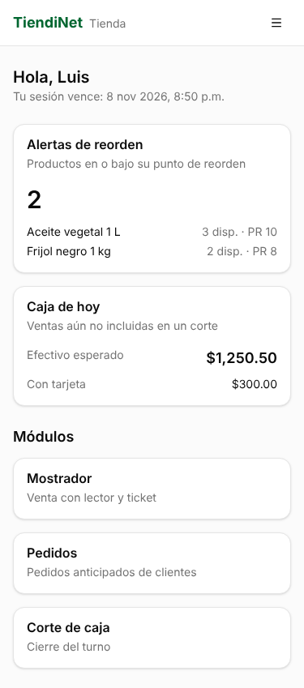
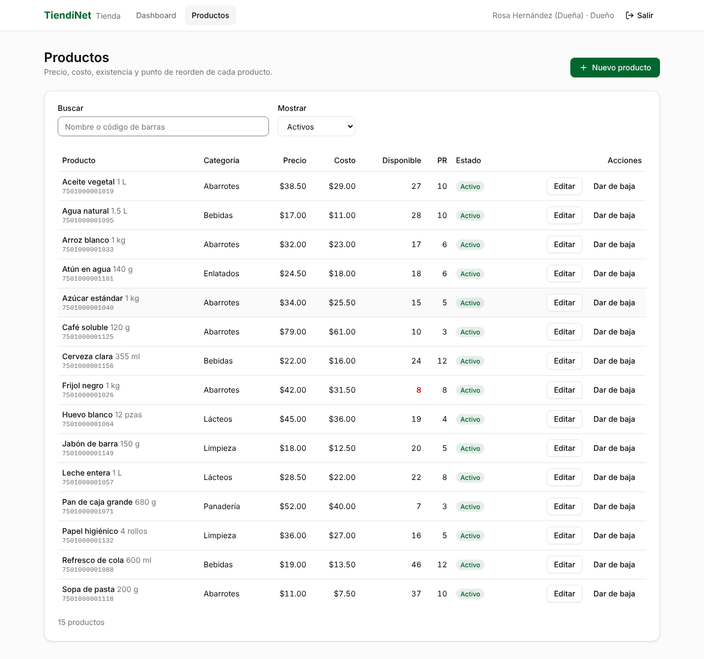
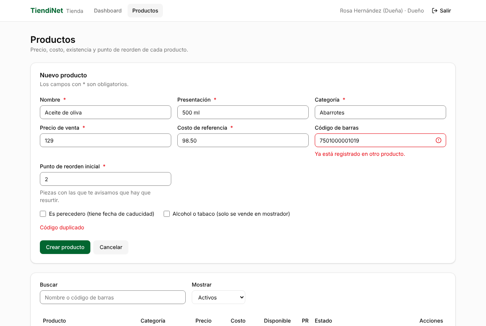
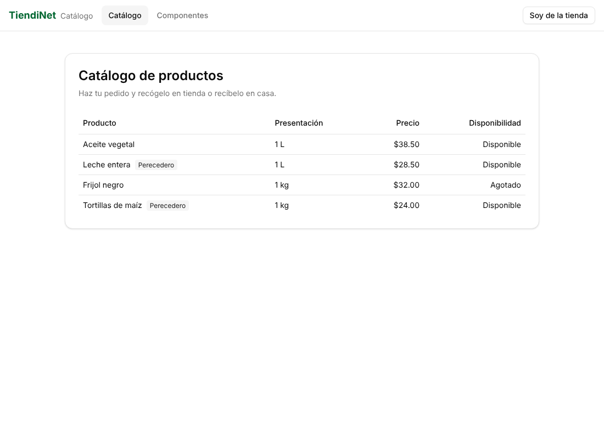

# TiendiNet


Punto de venta, inventario por lotes y tienda en línea para **una tienda de abarrotes de barrio**. Proyecto del equipo 18 de TC5062.

**Demo en video (5 min):** [`S11_A1/demo_proyecto.mp4`](S11_A1/demo_proyecto.mp4)

## Contenido

1. [El problema y el valor](#1-el-problema-y-el-valor)
2. [Estado actual](#2-estado-actual)
3. [Arquitectura](#3-arquitectura)
4. [Stack tecnológico](#4-stack-tecnológico)
5. [Instalación y ejecución local](#5-instalación-y-ejecución-local)
6. [Pruebas](#6-pruebas)
7. [Variables de entorno](#7-variables-de-entorno)
8. [URL de producción](#8-url-de-producción)
9. [Capturas de pantalla](#9-capturas-de-pantalla)
10. [Estructura del repositorio y documentación](#10-estructura-del-repositorio-y-documentación)
11. [Equipo](#11-equipo)

## 1. El problema y el valor

**El problema.** La dueña de la tienda anota las ventas en una libreta, lleva el inventario de memoria, recibe los precios de los proveedores por WhatsApp y toma encargos de los vecinos por mensaje. En la entrevista con el equipo (semana 2) dijo que le cuesta saber:

- qué productos se van a acabar antes de que se acaben
- si la caja cuadra al final del día
- a qué proveedor le conviene comprarle, comparando precios que llegan en presentaciones distintas
- qué productos están por caducar

Ella se describe como poco afín a la tecnología. El sistema lo operará su hija, con acceso completo.

**Lo que entrega TiendiNet.** Una aplicación web con dos portales sobre una API REST:

| Para quién | Qué resuelve | Cómo se mide el éxito (SRS 2.5) |
|---|---|---|
| Dueña y empleados (**Portal Tienda**) | Cobrar en mostrador con lector de código de barras y que el inventario se descuente al instante, recibir mercancía por lote con caducidad, alerta cuando un producto llega a su punto de reorden, corte de caja y comparar proveedores | Menos faltantes, caja cuadrada cada día, decidir una compra en unos 5 minutos |
| Vecinos (**Portal Clientes**) | Ver el catálogo desde el celular, armar un pedido, pagarlo en línea y recogerlo o recibirlo en casa | Ventas fuera del mostrador sin vender dos veces lo mismo |

La regla de negocio que no se negocia es **cero sobreventas** (RNF-06): lo que se cobra en mostrador y lo apartado en línea nunca pueden dejar existencias negativas.

Especificación completa: [`S09_A1/SRS_equipo.md`](S09_A1/SRS_equipo.md) (29 requerimientos funcionales del MVP, 131 criterios de aceptación).

## 2. Estado actual

El proyecto está **a medio camino del MVP**. Así está cada parte hoy (detalle por requerimiento en [`S11_A1/matriz_trazabilidad.md`](S11_A1/matriz_trazabilidad.md)):

| Parte | Funciona | Falta |
|---|---|---|
| **API** | 43 de las 109 operaciones del contrato (más 3 alias de la actividad de seguridad): autenticación JWT con 3 roles, usuarios, productos, recepciones por lote, búsqueda POS, venta con FEFO e idempotencia, alertas de reorden, vista previa de la caja del día, carrito y configuración | Ajustes, punto de reorden calculado, proveedores A y B, ofertas, cancelación, cierre del corte de caja, catálogo público, pedidos, pagos, reembolsos y reportes (66 operaciones) |
| **Portal Tienda** | Login, ruta protegida, dashboard con alertas de reorden y caja de hoy, y la pantalla de **productos** (consultar, dar de alta, editar y dar de baja), todo con el backend real | Pantallas de mostrador, recepción de mercancía, pedidos y corte |
| **Portal Clientes** | Página de catálogo | Con el backend real falla porque `GET /catalogo` aún no existe. Funciona con la API simulada |
| **Requerimientos** | 4 completos en la API (RF-04, 05, 15, 16), 8 parciales | 17 sin implementar |

## 3. Arquitectura

Monolito modular en capas, con puertos y adaptadores (ADR-001, [`S05_S06_A1/arquitectura_equipo.md`](S05_S06_A1/arquitectura_equipo.md)). Los dos portales son un solo proyecto Vite multipágina con un bundle por portal. La API es un proceso FastAPI que habla con una sola base PostgreSQL. Las líneas punteadas son componentes del diseño que **todavía no existen** en el código.



**Cómo fluye una petición.** El navegador llama a `/api/...`. En desarrollo, el proxy de Vite la reenvía a `http://localhost:8000` sin el prefijo, así que no hace falta configurar CORS. En la API, `MiddlewareAutenticacion` exige `Authorization: Bearer <JWT>` en toda ruta que no esté en `RUTAS_PUBLICAS` (una ruta nueva queda protegida por omisión) y rechaza con 401 un token vencido, alterado o de una cuenta desactivada. Después, las dependencias `DUENO`, `TIENDA` y `CLIENTE` de cada ruta aplican el rol y responden 403.

**Decisiones clave.**

- **Una transacción por operación de negocio.** Confirmar una venta bloquea las filas de los productos en orden de id, descuenta los lotes con FEFO, guarda de qué lote salió cada unidad (`salida_lote`), asigna folio, escribe la auditoría y la clave de idempotencia, todo en el mismo `commit`. Así se cumple «cero sobreventas»: 50 cobros simultáneos sobre 10 unidades dan exactamente 10 ventas.
- **`Idempotency-Key` en los POST que cobran o mueven existencia.** El internet de la tienda es intermitente: si se pierde la respuesta y el cajero reintenta, la API devuelve la venta original en lugar de cobrar dos veces.
- **Contrato primero.** [`S09_A1/openapi_equipo.yaml`](S09_A1/openapi_equipo.yaml) (109 operaciones, cada una con sus `RF-XX-AC-Y`) es la fuente de verdad. El frontend genera sus tipos desde ese archivo y el backend se verifica contra él (`verificar_api.py`, `verificar_roles.py`).
- **Existencia derivada.** La disponible (física − apartado − caducado) la calcula la vista `v_existencia_producto`, así no se guarda un número que pueda desincronizarse.

## 4. Stack tecnológico

| Capa | Tecnología | Versión | Propósito |
|---|---|---|---|
| Backend | Python | 3.10 o más reciente (probado con 3.11 y 3.13) | Lenguaje de la API |
| | FastAPI | 0.162.0 | Rutas REST, validación y documentación interactiva en `/docs` |
| | Uvicorn | 0.54.0 | Servidor ASGI |
| | SQLAlchemy | 2.1.6 | ORM, transacciones y bloqueo por fila (`with_for_update`) |
| | psycopg | 3.3.6 | Driver de PostgreSQL |
| | Pydantic (dependencia de FastAPI) | 2.14 | Cuerpos de petición estrictos (`StrictInt`, `extra="forbid"`) |
| | bcrypt | 5.0.0 | Hash de contraseñas, costo 12 |
| | PyJWT | 2.15.0 | Tokens HS256 con `exp`, `iat` y `sub` obligatorios |
| | python-dotenv | 1.2.3 | Carga del `.env` |
| Base de datos | PostgreSQL | 16 | BD concentradora: 37 tablas, secuencias de folio, vista de existencias, función `f_normaliza` |
| Frontend | React | 19.3.1 | Interfaz de los dos portales |
| | TypeScript | 5.9.3 | Tipos generados del contrato |
| | Vite | 8.3.6 | Construcción multipágina y proxy `/api` |
| | Tailwind CSS + shadcn/ui | 4.3.5 / estilo new-york | Estilos y componentes base (botón, campo, tarjeta, tabla) |
| | React Router | 8.5.1 | Rutas y ruta protegida por rol |
| | TanStack Query | 5.107.1 | Caché y estado de los datos de la API |
| | Zustand | 5.1.0 | Sesión (JWT en `sessionStorage`) |
| | openapi-fetch / openapi-typescript | 0.17.0 / 7.13.0 | Cliente HTTP tipado desde `openapi_equipo.yaml` |
| Pruebas | Vitest + Testing Library | 5.1.0 / 16.3.3 | Pruebas de componentes y del flujo de login |
| | axe-core | 4.14.0 | Accesibilidad WCAG 2.1 AA |
| | oxlint | 1.92.0 | Lint del frontend |
| | httpx, PyYAML, openapi-schema-validator | última | Scripts de verificación de la API contra el contrato |
| Entorno | Node.js | 20.19 o más reciente (probado con 22 y 24) | Herramientas del frontend |

## 5. Instalación y ejecución local

Probado desde cero el 25/11/2026 en Ubuntu 24.04 y el 26/11/2026 en Windows 11 con PowerShell 5.1. Los comandos son para bash. Las diferencias para Windows se indican en cada paso.

> **En Windows, antes de empezar**, en cada ventana de PowerShell:
>
> ```powershell
> Set-ExecutionPolicy -Scope Process Bypass -Force   # permite activar el venv y correr npm
> $env:PGCLIENTENCODING = "UTF8"                      # para que psql cargue bien los acentos de los .sql
> ```
>
> Si `psql` no se reconoce, agrégalo al PATH una vez: `[Environment]::SetEnvironmentVariable("Path", [Environment]::GetEnvironmentVariable("Path", "User") + ";C:\Program Files\PostgreSQL\16\bin", "User")` y abre otra ventana.

### Requisitos

- **Git**
- **PostgreSQL 16**, con `psql` en el PATH
- **Python 3.10** o más reciente
- **Node.js 20.19** o más reciente, con npm

### Paso 1. Clonar el repositorio

```bash
git clone https://github.com/CLA-TC5062-SN2026/TC5062-18.git
cd TC5062-18
```

### Paso 2. Crear la base de datos y cargar el esquema

Como superusuario de PostgreSQL, crea el usuario y la base. Usa la contraseña `tiendinet` en local, porque `backend/verificar_api.py` la espera así:

```bash
psql -U postgres -c "CREATE USER tiendinet WITH PASSWORD 'tiendinet';"
psql -U postgres -c "CREATE DATABASE tiendinet OWNER tiendinet;"
```

En Linux, si `postgres` no acepta tu usuario, antepón `sudo -u postgres`. En Windows, ejecuta los comandos desde «SQL Shell (psql)» o agrega `C:\Program Files\PostgreSQL\16\bin` al PATH.

Carga el esquema y los datos de prueba. **El esquema está en `S05_S06_A1/`**, no en `backend/`:

```bash
psql -h localhost -U tiendinet -d tiendinet -v ON_ERROR_STOP=1 -f S05_S06_A1/esquema_bd.sql
psql -h localhost -U tiendinet -d tiendinet -v ON_ERROR_STOP=1 -f backend/datos_prueba.sql
```

`esquema_bd.sql` ya trae los proveedores A, B y «Otro (ruta)». `datos_prueba.sql` crea 3 usuarios (contraseña `Tienda2026` para todos) y los códigos postales 72000 y 72010. **No crea productos** (ver el paso 7).

| Usuario | Correo | Rol |
|---|---|---|
| Rosa Hernández | `duena@tiendinet.mx` | Dueña |
| Luis Pérez | `empleado@tiendinet.mx` | Empleado |
| Ana Torres | `ana@correo.mx` | Cliente |

> Para volver a una base limpia: `DROP DATABASE tiendinet WITH (FORCE); CREATE DATABASE tiendinet OWNER tiendinet;` (como `postgres`) y repite las dos cargas. `WITH (FORCE)` cierra las conexiones abiertas del backend; después reinicia `uvicorn`.

### Paso 3. Configurar las variables de entorno del backend

```bash
cd backend
cp .env.example .env                   # PowerShell: Copy-Item .env.example .env
```

Edita `.env`:

- `DB_PASSWORD=tiendinet`
- `JWT_SECRET=` un secreto propio de 32 caracteres o más. Genéralo con:
  ```bash
  python -c "import secrets; print(secrets.token_urlsafe(48))"
  ```

Sin `JWT_SECRET`, o si es corto, la API no arranca a propósito. La lista completa de variables está en la [sección 7](#7-variables-de-entorno).

### Paso 4. Instalar dependencias y levantar el backend

```bash
python -m venv .venv
source .venv/bin/activate              # PowerShell: .venv\Scripts\Activate.ps1
pip install -r requirements.txt
uvicorn app.main:app --reload --port 8000
```

Comprueba en otra terminal:

```bash
curl http://localhost:8000/salud
# {"estado":"ok","postgresql":"16.x ...","tablas":37}
```

La documentación interactiva de la API está en http://localhost:8000/docs. Sirve para consultar el contrato y probar las rutas públicas (`POST /auth/sesiones`). Como la autenticación vive en un middleware, Swagger no muestra el botón **Authorize**: las rutas protegidas sin pantalla (recepciones, ventas) se prueban con `curl` y el encabezado `Authorization: Bearer <token>`, o con `venta_demo.py` (paso 7).

### Paso 5. Configurar e instalar el frontend

En una terminal nueva, desde la raíz del repo:

```bash
cd frontend/tiendinet-frontend
npm ci
```

Crea `frontend/tiendinet-frontend/.env` con este contenido:

```dotenv
VITE_API_URL=/api
API_PROXY_TARGET=http://localhost:8000
```

### Paso 6. Levantar el frontend

```bash
npm run dev
```

| Portal | URL |
|---|---|
| Portal Tienda (login) | http://localhost:5173/tienda/login |
| Portal Clientes (catálogo) | http://localhost:5173/ |
| Galería de componentes | http://localhost:5173/componentes |

Inicia sesión con `duena@tiendinet.mx` / `Tienda2026`. Con el backend real funcionan el login, el dashboard (alertas y caja de hoy) y la pantalla de productos, a la que se entra desde la tarjeta «Inventario y reorden» o desde el menú. El Empleado (`empleado@tiendinet.mx`) no ve productos porque incluyen costos.

> **Limitación conocida.** Con el backend real, el catálogo del Portal Clientes muestra error, porque llama a `GET /catalogo`, que el backend todavía no implementa. Para verlo con datos, usa la API simulada del frontend:
>
> ```bash
> PUERTO_API_SIMULADA=8001 npm run api:simulada   # PowerShell: $env:PUERTO_API_SIMULADA=8001; npm run api:simulada
> # y en .env: API_PROXY_TARGET=http://localhost:8001 (reinicia npm run dev)
> ```
>
> Usuarios de la API simulada: `duena@tiendinet.local` y `empleado@tiendinet.local`, contraseña `Demo1234`.

### Paso 7 (opcional). Cargar productos y ventas de ejemplo

`datos_prueba.sql` no trae productos. Con la API arriba, este script da de alta 15 productos de abarrotes con código de barras, los recibe por lote (la leche en dos lotes con caducidad distinta) y registra 4 ventas del día, así el dashboard ya muestra una alerta de reorden y la caja de hoy:

```bash
cd backend
source .venv/bin/activate
python cargar_datos_demo.py
```

Para ver una venta en mostrador completa (todavía no tiene pantalla), con la API arriba y los datos cargados:

```bash
python venta_demo.py
```

Se pausa con Enter en cada paso: el Empleado escanea el aceite (27 disponibles), agrega 2, cobra en efectivo con $100 (cambio $23 y folio), vuelve a escanear (25) e intenta vender más de lo que hay (409 «Existencia insuficiente»). Es el recorrido del video de demo.

No mezcles estos scripts con `verificar_api.py` en la misma base: la verificación necesita una base recién cargada y crea sus propios productos de prueba.

## 6. Pruebas

El proyecto **no tiene una carpeta `backend/tests/` con pytest**. El backend se verifica con scripts de integración que se ejecutan contra la API levantada (paso 4) y con la base recién cargada (paso 2).

### Backend

```bash
cd backend
source .venv/bin/activate
pip install httpx pyyaml openapi-schema-validator     # dependencias de los scripts, no están en requirements.txt

python verificar_api.py http://localhost:8000 ../S09_A1/openapi_equipo.yaml
python verificar_roles.py ../S09_A1/openapi_equipo.yaml
./pruebas_seguridad.sh                                                # bash; en Windows usa Git Bash
python ../S11_A1/evidencia/verificacion_complementaria.py
```

| Script | Qué verifica | Resultado esperado |
|---|---|---|
| `verificar_api.py` | 113 peticiones de éxito, error y seguridad. Por cada respuesta: que la ruta exista en el contrato, que el código HTTP esté declarado y que el cuerpo valide contra el schema. Al final revisa la base: FEFO, folio, idempotencia, auditoría y bcrypt | `147/147 verificaciones correctas` |
| `verificar_roles.py` | Que el rol exigido por cada ruta coincida con el del contrato | `46 operaciones; 41 protegidas, 5 públicas; diferencias con el contrato: 0` |
| `pruebas_seguridad.sh` | Sin token, token alterado, rol incorrecto y rol correcto | 401, 401, 403, 200 |
| `verificacion_complementaria.py` | Criterios sin caso en `verificar_api.py`: pago con tarjeta, alertas de reorden (también por `GET /alertas`), vista previa de la caja, lotes que caducan hoy o ya caducaron, precio histórico y **concurrencia** (2 cobros por la última unidad y 50 cobros sobre 10 unidades) | `18/18 verificaciones correctas` |

`verificar_api.py` necesita una base recién cargada y tiene la contraseña `tiendinet` fija en su conexión. Los resultados de la última corrida están en [`S11_A1/evidencia/verificacion_resultado.txt`](S11_A1/evidencia/verificacion_resultado.txt).

### Frontend

```bash
cd frontend/tiendinet-frontend
npm test              # Vitest: 49 pruebas en 8 archivos
npm run typecheck     # tsc -b
npm run lint          # oxlint
```

Incluyen el flujo de login completo (9 pruebas), la pantalla de productos (10 pruebas: alta, edición, baja con confirmación, 409 por código duplicado, validación, acceso por rol y axe-core), el cliente HTTP (interceptor JWT, `Idempotency-Key`, manejo de 401, 422, 500 y fallas de red), la accesibilidad de los componentes y una prueba que falla si alguna de las 109 operaciones del contrato no tiene su función en la capa de servicios.

## 7. Variables de entorno

Los valores de ejemplo son los de `.env.example`. Ningún secreto real va en el repositorio: `.env` está en `.gitignore`.

### Backend (`backend/.env`)

| Variable | Obligatoria | Por defecto | Descripción |
|---|---|---|---|
| `DB_HOST` | No | `localhost` | Servidor de PostgreSQL |
| `DB_PORT` | No | `5432` | Puerto de PostgreSQL |
| `DB_NAME` | No | `tiendinet` | Base concentradora |
| `DB_USER` | No | `tiendinet` | Usuario de la base |
| `DB_PASSWORD` | **Sí** | vacío | Contraseña del usuario. En local, `tiendinet` (la espera `verificar_api.py`) |
| `JWT_SECRET` | **Sí** | Sin valor | Secreto HS256 de 32 caracteres o más. Sin él la API no arranca |
| `JWT_EXPIRATION` | No | `60` | Minutos de vida del token de Dueño y Empleado (1 a 1440) |
| `JWT_EXPIRATION_CLIENTE` | No | `1440` | Minutos de vida del token de Cliente (1 a 10080) |
| `BCRYPT_ROUNDS` | No | `12` | Costo de bcrypt (10 a 15) |
| `MOSTRAR_ENLACES_EN_CONSOLA` | No | `false` | Solo en desarrollo: imprime en la consola el token de activación de cuentas nuevas, porque aún no hay servidor de correo |
| `API_PORT` | No | `8000` | Viene en `.env.example`, pero el código no la lee: el puerto real se fija con `uvicorn ... --port 8000` |

### Frontend (`frontend/tiendinet-frontend/.env`)

| Variable | Obligatoria | Por defecto | Descripción |
|---|---|---|---|
| `VITE_API_URL` | No | `/api` | URL base de la API que usa el navegador. En desarrollo, `/api` pasa por el proxy de Vite. En producción, la URL pública de la API |
| `API_PROXY_TARGET` | No | `http://localhost:8000` | Solo desarrollo: a dónde reenvía el proxy `/api` |
| `PUERTO_API_SIMULADA` | No | `8000` | Puerto de `npm run api:simulada`. Usa otro (por ejemplo 8001) si el backend real ocupa el 8000 |

## 8. URL de producción

**TiendiNet no está desplegado en producción.** El SRS (sección 1.2) deja el despliegue productivo en la nube fuera del alcance del MVP. El plan era ejecutarlo con Docker Compose en un equipo del proyecto, expuesto por un túnel HTTPS para los portales y para el webhook de Mercado Pago (SRS 2.1). Ese empaquetado todavía no existe. La demo se hace con el stack local de la sección 5.

<!-- Si el equipo publica un túnel o despliegue para la demo, reemplazar este párrafo por la URL:
| Portal Tienda | https://... /tienda/login |
| Portal Clientes | https://... / |
| API | https://... /docs |
-->

## 9. Capturas de pantalla

Tomadas el 25/11/2026 con el stack local.

**Inicio de sesión del Portal Tienda** (backend real). A la derecha, credenciales incorrectas: la API responde 401 con el mismo mensaje sin revelar si el correo existe (RF-01-AC-2).

| Login | Error de credenciales |
|---|---|
|  |  |

**Dashboard de la Dueña** (backend real, con los datos de `cargar_datos_demo.py`): el frijol llegó a su punto de reorden y la caja del día separa efectivo y tarjeta. A la derecha, el **dashboard del Empleado en celular** (375 px), que no ve «Inventario y reorden» ni «Costos y ofertas» (RF-01-AC-3).

| Dueña, escritorio | Empleado, móvil |
|---|---|
|  |  |

**Productos** (backend real, RF-04). La lista muestra precio, costo, disponible y punto de reorden, y marca en rojo lo que hay que resurtir. Al dar de alta un producto con un código de barras que ya existe, la API responde 409 «Código duplicado» y el formulario lo señala en el campo.

| Lista de productos | Alta con código duplicado |
|---|---|
|  |  |

**Catálogo en línea del Portal Clientes** (API simulada). Muestra la etiqueta «Perecedero» y el estado «Agotado», sin costo ni existencia exacta (RF-21).



**Con el backend real**, el catálogo muestra el error controlado de la capa de servicios, porque `GET /catalogo` aún no existe en la API: [`catalogo_backend_real.png`](docs/capturas/catalogo_backend_real.png).

El recorrido completo del login está animado en [`frontend/tiendinet-frontend/docs/img/flujo_login.gif`](frontend/tiendinet-frontend/docs/img/flujo_login.gif).

## 10. Estructura del repositorio y documentación

```
TC5062-18/
├── README.md                      ← este archivo
├── backend/                       API FastAPI
│   ├── app/
│   │   ├── main.py                arranque, middleware y routers
│   │   ├── seguridad.py           bcrypt, JWT, middleware, roles
│   │   ├── rutas/                 auth, acceso, productos, inventario, proveedores, configuracion, ventas, carrito
│   │   ├── modelos.py · esquemas.py · comun.py · errores.py · config.py · db.py
│   ├── datos_prueba.sql           usuarios y códigos postales de prueba
│   ├── cargar_datos_demo.py       15 productos de abarrotes, lotes y ventas del día para la demo
│   ├── venta_demo.py              venta en mostrador paso a paso contra la API (la usa el video)
│   ├── verificar_api.py · verificar_roles.py · pruebas_seguridad.sh
│   └── requirements.txt · .env.example
├── frontend/tiendinet-frontend/   dos portales en un proyecto Vite (ver su README)
│   ├── index.html · tienda/index.html
│   ├── src/ (components, pages, services, stores, types, lib); pages/tienda: login, dashboard, productos
│   ├── contrato/openapi_equipo.yaml
│   ├── scripts/api-simulada.mjs
│   └── docs/                      flujo de login, capa de servicios, accesibilidad, componentes
├── docs/capturas/                 capturas de este README
├── S03_A1/ … S09_A1/              entregables por actividad (tabla de abajo)
└── S11_A1/                        documentación final: matriz, retrospectiva, evidencia, video de demo
```

| Actividad | Documentos principales |
|---|---|
| S03-A1 · Requisitos y backlog | `SRS_equipo.md`, `backlog_completo.md`, `diferencias_SRS.md`, `priorizacion_comparada.md`, `reflexion.md` |
| S03-A2 · Sprint 1 | `sprint1_planning.md`, `tareas_tecnicas.md`, `definition_of_done.md` |
| S05-S06-A1 · Diseño y CRUD | `arquitectura_equipo.md`, `openapi_equipo.yaml`, `diagrama_clases_equipo.puml`, `esquema_bd.sql`, `revision_sql.md`, `diferencias_diseno.md` |
| S05-S06-A2 · Seguridad | `revision_seguridad.md`, `pruebas_auth.mp4` |
| S07-S08 · Frontend | `decision_stack_frontend.md`, `revision_componentes.md`, `accesibilidad.md`, `capa_servicios.md` |
| S09-A1 · Revisión de código | `code_review.md` |
| **S11-A1 · Cierre** | [`matriz_trazabilidad.md`](S11_A1/matriz_trazabilidad.md), [`retrospectiva_proyecto.md`](S11_A1/retrospectiva_proyecto.md), [`evidencia/`](S11_A1/evidencia/), [`demo_proyecto.mp4`](S11_A1/demo_proyecto.mp4) |

## 11. Equipo

| Integrante | Rol Scrum (Sprint 1) |
|---|---|
| José Alberto Ramírez Morales | Product Owner y Developer |
| Víctor Manuel Jurado Herrera | Scrum Master y Developer |
| Ángel Vega Martínez | Developer |
| Adrián Alberto Cortés Alvarez | Developer |

Curso TC5062, Tecnológico de Monterrey, 2026.
