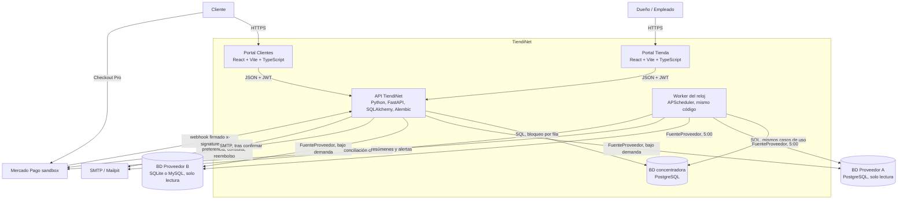
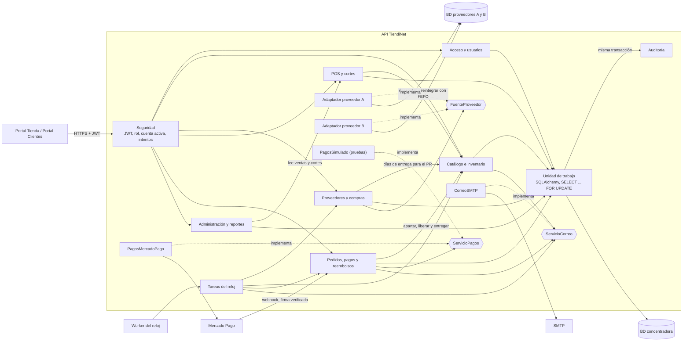

# Arquitectura de equipo — TiendiNet

Monolito modular en capas con puertos y adaptadores: dos portales web, una API REST, un worker para los procesos con horario y una sola base PostgreSQL. Se documenta en dos niveles del modelo C4: contenedores (nivel 2) y componentes de la API (nivel 3).

Los diagramas definitivos están en Mermaid en este documento y en PlantUML (C4) en `diagrama_contenedores_equipo.puml` y `diagrama_componentes_equipo.puml`; ambos muestran lo mismo. La comparación con los diagramas individuales está en `diferencias_arquitectura.md`.

## Por qué esta forma

El SRS (sección 2.1) fija dos portales web, una API REST, PostgreSQL, un adaptador por proveedor y `ServicioPagos` con Mercado Pago sandbox más un adaptador simulado. El catálogo es público y el portal de tienda exige sesión (RF-01-AC-6), así que son dos contenedores que comparten componentes de React.

El reloj no vive dentro del proceso que atiende HTTP. Los horarios (5:00, 6:00, 7:00, cada 10 minutos, 15 minutos, 30 minutos y 20:00) tienen que correr aunque nadie use la API. El worker es el mismo código: invoca los mismos casos de uso que `POST /tareas/...`.

Los puertos siguen RNF-15: otro proveedor es otro adaptador de `FuenteProveedor`; otra pasarela es otra implementación de `ServicioPagos`. Las pruebas no llaman a Mercado Pago: usan el adaptador simulado, que es un componente dentro de la API y no un contenedor aparte.

## Contenedores (C4 nivel 2)

## Componentes de la API (C4 nivel 3)

- **Seguridad** valida el JWT, que la cuenta siga activa y el rol de cada operación (RF-01, RF-03-AC-2, RNF-04). El webhook no pasa por aquí: lo autentica la firma `x-signature`.
- **Unidad de trabajo** abre una transacción por caso de uso y bloquea la fila de cada producto en orden de id (RNF-06). La auditoría se escribe en esa misma transacción (RNF-07) y no tiene endpoint.
- **`FuenteProveedor`** ofrece `leerOfertas()`, con un adaptador por base externa.
- **`ServicioPagos`** ofrece `crearPreferencia()`, `verificarFirma()`, `consultarPago()` y `reembolsar()`, con dos implementaciones: Mercado Pago y la simulada.
- **`ServicioCorreo`** ofrece `enviar(destinatario, plantilla, datos)` sobre SMTP.

## Encaje con el contrato y el SRS

| Pieza | Contrato | SRS |
|---|---|---|
| Portal Tienda y Portal Clientes | JWT en el portal de tienda; `GET /catalogo` y `GET /configuracion/publica` sin sesión | RF-01-AC-6, RF-21. React, Vite y TypeScript, sección 2.1 |
| API | `openapi_equipo.yaml`. Confirmar venta, crear pedido, cancelar y procesar un webhook bloquean la fila de existencia. Los POST que cobran o mueven existencia exigen `Idempotency-Key` | RNF-06. FastAPI, SQLAlchemy y Alembic |
| Módulos | Tags del contrato: acceso, productos e inventario, proveedores, punto de venta, pedidos, pagos, reembolsos, configuración, reportes y tareas | RF-01 a RF-29 |
| Worker | `POST /tareas/calcular-puntos-reorden`, `avisos-caducidad`, `expirar-pedidos`, `conciliar-pagos`, `marcar-no-recogidos`, `resolver-faltantes-vencidos`. `fechaReferencia` fija el instante en pruebas | 6:00, 7:00, 15 min, 10 min, 20:00 y plazo de faltante. La sincronización de las 5:00 es `POST /sincronizaciones-proveedores` |
| Proveedores A y B | La sincronización acepta un proveedor o los dos y devuelve el resumen (201). Los dos se sincronizan en paralelo, con límite de 10 segundos por base, y una segunda sincronización en curso responde 409 | RF-10, RNF-03. Esquemas distintos, solo lectura |
| Mercado Pago | `POST /webhooks/pagos` recibe el aviso de Mercado Pago, verifica `x-signature` y consulta el pago en `ServicioPagos`. El cliente paga fuera del sitio | RF-23, S-07. TiendiNet no guarda la tarjeta |
| Adaptador simulado | Componente que implementa `ServicioPagos`. Envía avisos con el formato de Mercado Pago y responde la consulta del pago con el monto y el estado que fija la prueba | RNF-15 y el riesgo de Mercado Pago en el SRS |
| Correo | Alertas, activación, faltantes y resúmenes salen tras confirmar la operación | SMTP. Mailpit en local |
| PostgreSQL | Una sola base: productos, lotes, ofertas, ventas, pedidos, pagos y auditoría | Sección 2.1. Sin cola ni segunda base |
