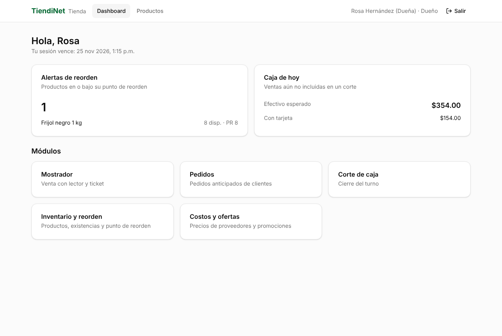
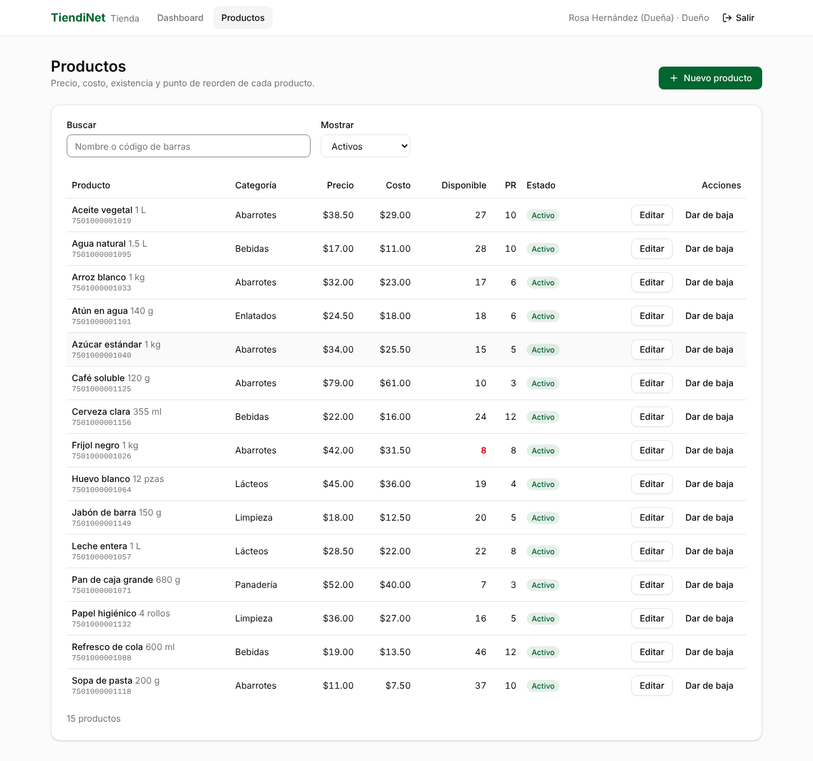
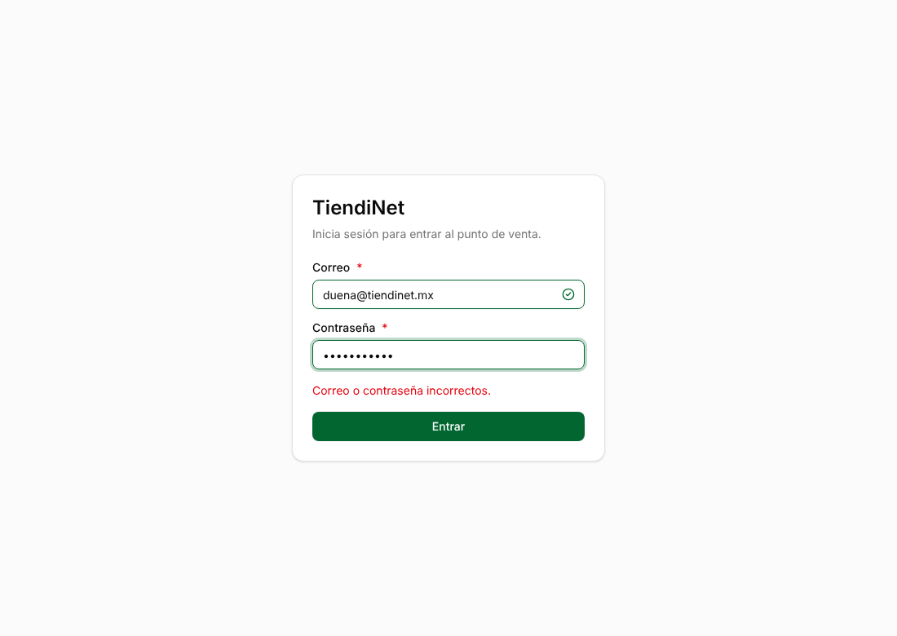
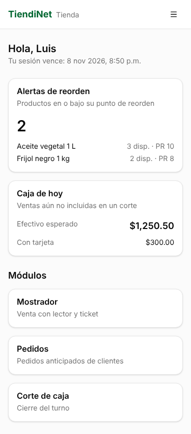
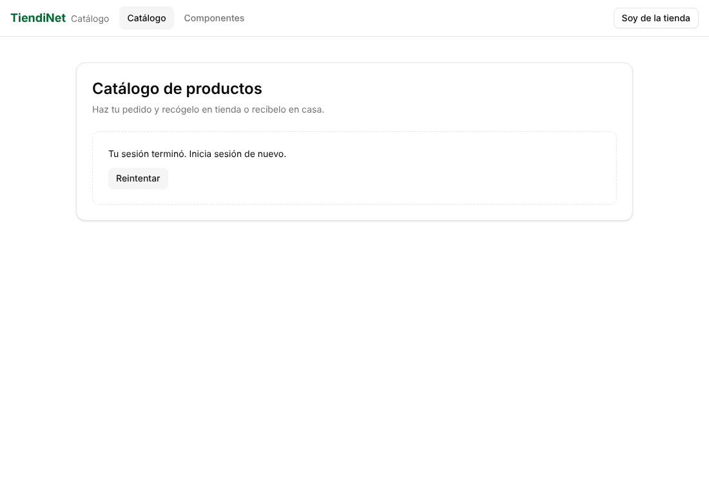

# Retrospectiva del proyecto y consistencia problema-solución: TiendiNet

| Campo | Valor |
|---|---|
| Equipo | 18 · José Alberto Ramírez Morales · Ángel Vega Martínez · Víctor Manuel Jurado Herrera · Adrián Alberto Cortés Alvarez |
| Fecha | 25/11/2026 |
| Periodo | Semanas 2 a 11: del SRS consolidado (S03-A1) a la documentación final (S11-A1) |
| Evidencia | `S11_A1/matriz_trazabilidad.md`, `S11_A1/evidencia/verificacion_resultado.txt`, `docs/capturas/` y los entregables de cada actividad |

Cómo se hizo: el agente reunió los datos (corrió el stack completo desde cero, las verificaciones y las capturas) y redactó un borrador. El equipo lo revisó y ajustó. Las cifras salen de las corridas del 25/11/2026, no de memoria.

## Sección A. Retrospectiva Scrum

### A.1 ¿Qué salió bien?

**1. Los requisitos aguantaron todo el proyecto.** Antes de escribir código consolidamos los cuatro SRS individuales, resolvimos 22 conflictos (`diferencias_SRS.md`) y dejamos 131 criterios con ID `RF-XX-AC-Y` y datos concretos ($38.50, PR 5, 15 minutos). Ese ID atraviesa el backlog, las 109 operaciones del contrato (`x-acceptance-criteria`) y las pruebas. Gracias a eso, la matriz de trazabilidad de esta entrega se armó en horas y criterio por criterio, no con estimaciones.

**2. El contrato primero permitió trabajar en paralelo y verificar sin discusión.** `openapi_equipo.yaml` fue la fuente de verdad. El frontend genera sus tipos desde ese archivo, y una prueba (`cobertura.test.ts`) falla si falta la función de alguna operación. El backend se valida contra el mismo archivo: `verificar_api.py` revisa código HTTP y schema en 113 peticiones (147/147), y `verificar_roles.py` encuentra 0 diferencias de rol en 44 operaciones. Las discusiones sobre «qué debe responder» se resolvían leyendo el contrato.

**3. El núcleo del punto de venta es sólido.** La confirmación de venta ocurre en una sola transacción: bloquea filas en orden de id, descuenta con FEFO, guarda de qué lote salió cada unidad, asigna folio, audita y es idempotente. Hoy lo comprobamos con carga real: **50 cobros simultáneos sobre 10 unidades dan exactamente 10 ventas y 40 rechazos «Producto agotado», y la existencia queda en 0** (RNF-06). Es la regla de negocio más importante del sistema, y se cumple.

**4. La seguridad se diseñó para fallar del lado seguro.** El middleware protege toda ruta por omisión, y para abrir una hay que agregarla a `RUTAS_PUBLICAS` a propósito. La revisión de S05-S06-A2 encontró y corrigió cinco problemas que nadie había pedido revisar: el encabezado `X-Usuario-Id`, que permitía hacerse pasar por la Dueña, contraseñas de más de 72 bytes que bcrypt convertía en error 500, un JWT que seguía sirviendo después de desactivar la cuenta, el rol que viajaba en el token sin revalidarse y la diferencia de ~210 ms en el login que revelaba qué correos existen.

**5. La revisión de cada propuesta del agente quedó documentada.** Ninguna salida del agente entró sin revisión, y cada actividad registra qué se cambió y por qué: 19 ajustes al backlog, 12 puntos de la DoD ajustados, 9 divergencias del CRUD generado, 5 hallazgos de seguridad, 9 problemas de accesibilidad y 7 hallazgos en el code review. Esa disciplina es la razón de que lo implementado funcione.

**6. El frontend cuidó la calidad desde el inicio**, aunque no avanzó tanto: 49 pruebas, accesibilidad WCAG 2.1 AA verificada con axe-core (el anillo de foco de shadcn/ui tenía 1.54:1 y se subió a 7.13:1) y un manejo centralizado de errores que convierte cada 401, 422, 500 o falla de red en un mensaje para el usuario.

### A.2 ¿Qué no salió bien?

**1. Comprometimos un alcance que no cabía.** El backlog tenía 134 SP en 6 sprints de ~24 SP. Al cierre, de los 131 criterios, **35 están cumplidos (27 %), 13 a medias y 83 sin implementar**. De los 18 requerimientos Must, solo 4 están completos (RF-04, RF-05, RF-15 y RF-16). El propio SRS anticipaba el riesgo («el alcance creció al integrar los cuatro SRS») y proponía revisar el avance en la semana 7 y recortar en un orden definido. Esa revisión no se hizo de manera formal, y el recorte ocurrió por omisión, no por decisión.

**2. Construimos por capas, no por historias.** El plan de sprints estaba pensado en rebanadas verticales (Sprint 2: vender en mostrador completo). Pero el ritmo real lo marcaron las actividades del curso, que iban por capa: diseño y CRUD (S05-S06), seguridad, componentes y capa de servicios (S07-S08), y revisión de código (S09). El resultado fueron capas bien hechas que no se juntaban: **hasta la semana 10 solo el inicio de sesión funcionaba de punta a punta.** En el sprint de cierre conectamos la pantalla de productos y el dashboard con el backend real, pero la venta, que es lo más completo de la API, sigue sin pantalla de mostrador. La meta M-2 del Sprint 1 («20 productos capturados desde la interfaz, no por script») se pudo cumplir hasta el final del proyecto, cuando ya no servía para planear.

**3. La brecha entre frontend y backend no se vio hasta el final.** El dashboard pide `GET /alertas` y `GET /cortes-caja/vista-previa`, y el catálogo pide `GET /catalogo`, y ninguno existe en el backend. Las pruebas del frontend usaban mocks y la API simulada, y las del backend no tocaban el frontend. Nadie levantó los dos juntos con datos reales hasta el cierre, y entonces el dashboard mostró «No encontrado» en sus dos tarjetas y el catálogo respondió «Tu sesión terminó» a un visitante sin sesión (`docs/capturas/catalogo_backend_real.png`). Las dos rutas del dashboard las implementamos en el sprint de cierre; el catálogo quedó pendiente.

**4. La DoD se quedó en papel.** Nuestra propia DoD (S03-A2) pedía CI en GitHub Actions con `ruff`, `eslint` y `pytest`, una prueba `test_RF_XX_AC_Y` por criterio, cobertura ≥ 70 %, migraciones y `docker compose up` en una máquina limpia. Nada de eso está en el repositorio: no hay `backend/tests/`, ni `.github/workflows`, ni Alembic, ni `docker-compose.yml`. Las verificaciones existen, pero son scripts que alguien tiene que acordarse de correr.

**5. Los riesgos técnicos grandes se pospusieron en lugar de atacarse primero.** Las historias de 13 SP (unificar proveedores A y B, y el pago con Mercado Pago) nunca se empezaron. El SRS proponía como mitigación «`ServicioPagos` con adaptador simulado desde la semana 1» y «fijar ambos esquemas simulados en la semana 1». No se hizo, y no existen la BD de los proveedores, ni `FuenteProveedor`, ni `ServicioPagos`, ni `ServicioCorreo`.

**6. No validamos con la clienta.** El Sprint 3 incluía un prototipo navegable para validar los valores ⚑ (zona de entrega, pedido mínimo, horario), y RNF-11 pedía una prueba cronometrada con la dueña y su hija. Ninguna de las dos ocurrió.

**7. Detalles que se escaparon** y que salieron al armar la matriz: la cantidad sugerida de la alerta usaba `2 × PR − disponible` en lugar de la fórmula del SRS (ya corregida), cuatro mensajes de error difieren del texto del SRS, `backend/README.md` apuntaba a un `esquema_bd.sql` que no estaba en esa ruta (ya corregida) y `verificar_api.py` tiene la contraseña de la base fija y sus dependencias no están en `requirements.txt`. Ninguno es grave, pero todos los habría atrapado un CI que corriera en limpio.

### A.3 ¿Qué haríamos diferente la próxima vez?

1. **Terminar una historia de punta a punta antes de abrir otra.** Si la actividad del curso pide «el frontend», entregar el frontend *de la historia que ya tiene backend*. Con el tiempo que tuvimos, habríamos preferido vender en mostrador desde la pantalla (RF-15 a RF-17) y ver alertas y corte de caja, antes que 109 funciones de servicio para endpoints que no existen.
2. **Re-planear con la velocidad real.** Medir lo terminado al final del Sprint 1, comparar contra los 24 SP supuestos y aplicar el orden de recorte en voz alta. Un MVP realista era el POS con inventario, alertas, corte y catálogo (unos 50 SP), dejando pedidos y pagos en línea como segunda entrega.
3. **Integración continua desde la semana 1, aunque sea mínima:** un workflow que cargue la base en limpio, levante la API y corra `verificar_api.py` y `npm test`. Un *smoke test* que levante frontend y backend juntos habría detectado la brecha de `/alertas` y `/catalogo` en el momento en que se escribió el dashboard.
4. **Pedir las pruebas junto con el código.** Cuando le pedíamos un endpoint al agente, la prueba pytest nombrada por criterio debía venir en la misma petición. Escribirlas después nunca ocurrió.
5. **Hacer primero un *spike* de lo riesgoso.** Una semana para el *sandbox* de Mercado Pago y dos BD simuladas de proveedores con un adaptador mínimo, aunque fuera feo, para saber cuánto cuesta de verdad.
6. **Mostrar algo a la clienta en la semana 4**, aunque fuera la pantalla de venta con datos falsos. Varias decisiones del SRS siguen marcadas ⚑ por no tener ese contacto.

### A.4 Análisis del uso de herramientas agentes

Usamos un agente de IA en todas las fases. Esta tabla resume dónde ayudó y dónde costó, con la evidencia de cada actividad.

| Fase | Qué hizo el agente | Dónde fue útil | Dónde generó trabajo adicional | Evidencia |
|---|---|---|---|---|
| **Requisitos y backlog** (S03-A1) | Comparó los 4 SRS, generó el backlog de 24 historias y priorizó como Product Owner | Encontró 22 conflictos entre los SRS, varios que no habíamos notado (quién puede cancelar ventas). Su priorización detectó que el corte de caja y las ventas diferidas eran baratas y valiosas, y aceptamos sus 4 propuestas | 19 ajustes al backlog: faltaba el criterio de concurrencia en la historia más crítica (HU-14), subestimó el pago y los proveedores (8 → 13 SP), redactó soluciones en lugar de necesidades y propuso bajar la cuenta de cliente sin ver que el pedido depende de ella | `diferencias_SRS.md`, `ajustes_backlog.md`, `priorizacion_comparada.md` (ρ = 0.77) |
| **Planeación** (S03-A2) | Propuso Sprint Goal, capacidad y DoD | Llegó a la capacidad correcta (18 SP) | Llegó a ese número con una velocidad supuesta. Su DoD era de un equipo profesional (cobertura de 90 %, *staging*, SAST, 2 revisores): ajustamos 12 puntos y agregamos 2 que no propuso (auditoría y pruebas por criterio) | `sprint1_planning.md`, `definition_of_done.md` |
| **Diseño** (S05-S06-A1) | Fusionó los 4 contratos, generó el esquema SQL de 37 tablas y el CRUD en FastAPI | Volumen y consistencia: 109 operaciones con IDs de criterio, restricciones en la base (30 de 30 pruebas de esquema) | El código generado traía los comportamientos por defecto de FastAPI y no los del contrato: formato de error propio, 422 donde iba 400, enteros flexibles (`"2"` aceptado), ids desordenados. Fueron 9 divergencias, y la primera corrida dio 91/104 | `revision_sql.md` |
| **Seguridad** (S05-S06-A2) | Generó autenticación, middleware y roles | Implementación correcta de JWT y bcrypt; tabla de rutas generada por script | No avisó que había dejado activo el `X-Usuario-Id` de la actividad anterior (suplantación total), ni del límite de 72 bytes de bcrypt, ni de la fuga por tiempo de respuesta. Los encontramos al revisar | `revision_seguridad.md` |
| **Frontend** (S07-S08) | Generó componentes base, login, dashboard y la capa de servicios | Para un equipo sin experiencia en React fue la diferencia entre tener o no tener frontend. La capa de servicios centraliza JWT, idempotencia y errores | Los componentes tenían errores (`asChild` + `loading`, menú móvil que no se cerraba) y heredaron un foco de 1.54:1 del tema por defecto. **Y lo más caro:** generó servicios y pantallas para endpoints que el backend no tenía, lo que dio una sensación de avance que no era real | `revision_componentes.md`, `accesibilidad.md`, `capturas/*_backend_real.png` |
| **Revisión de código** (S09-A1) | Analizó `confirmar_venta` y el resto del backend | Encontró una condición de carrera real en el generador de UUIDv7 y varios accesos a `None` | Propuso extraer `ServicioConfirmacionVenta` y repositorios (SRP, DIP); quedó como deuda | `code_review.md` |
| **Sprint de cierre y documentación final** (S10-S11) | Levantó el stack desde cero, corrió todas las verificaciones, escribió una verificación complementaria, construyó la pantalla de productos y las rutas `/alertas` y `/cortes-caja/vista-previa`, y redactó README, matriz y retrospectiva | Como **verificador** fue más valioso que como redactor: encontró la brecha frontend-backend, la fórmula de cantidad sugerida, la contraseña fija y la ruta equivocada del README. También probó la concurrencia que nadie había probado. Esta vez la pantalla vino con sus pruebas, y al correrlas salió un ciclo de redirección para el Empleado que no habríamos visto a mano | Tuvimos que revisar el tono de lo que escribió sobre nosotros: lo que «sentimos» lo tenemos que decir nosotros | `evidencia/`, esta matriz, `ProductosPage.test.tsx` |

**¿En qué fases fue más útil?**

- **Requisitos y trazabilidad.** Comparar documentos largos, encontrar contradicciones y mantener IDs consistentes en cientos de criterios es justo lo que hace mejor que nosotros.
- **Verificación automatizada.** Validar cada respuesta del código generado contra el contrato destapó divergencias que la lectura no vio (91/104 en la primera corrida de S05-S06). En esta entrega, el agente escribió `verificacion_complementaria.py` y comprobó la concurrencia de la venta, que nadie había probado.
- **Revisión**, cuando se le pidió explícitamente buscar problemas: seguridad, code review y esta matriz.

**¿En qué fases generó trabajo adicional?**

- **Generación de código.** Siempre tomó el camino por defecto del framework (errores de FastAPI, tema de shadcn/ui, `X-Usuario-Id` olvidado). Cada generación necesitó una revisión línea por línea contra el contrato.
- **Planeación.** Propone planes y DoD dimensionados para un equipo con más horas e infraestructura que nosotros.
- **El efecto más costoso fue indirecto.** Producir documentos y código era tan rápido que avanzamos en anchura (más módulos documentados, más servicios, más pantallas contra mocks) y no en profundidad. El repositorio tiene más de quince documentos de análisis bien hechos y una sola historia usable de punta a punta. El agente no causó esa decisión, pero la hizo muy fácil de tomar.

**¿Cambió nuestra forma de programar?**

Sí, en tres sentidos:

1. **Pasamos de escribir a especificar y revisar.** El *prompt* más efectivo resultó ser el contrato y los criterios del SRS: cuanto más concreto el criterio («responde 409 con "Código duplicado"»), mejor el código generado. Escribir buenos criterios se volvió más importante que escribir buen código.
2. **Aprendimos a desconfiar de lo que parece terminado.** Lo escribimos en la semana 3 («el borrador parece terminado, pero no lo está») y lo volvimos a vivir con el frontend en la semana 11. La lección práctica: la prueba de que algo funciona es ejecutarlo integrado, no que compile ni que sus pruebas unitarias pasen.
3. **Aprendimos un stack nuevo leyendo código ajeno.** Nadie sabía React ni TypeScript. Revisar lo que generaba el agente, con pruebas y axe-core, nos enseñó más que un tutorial, pero solo porque lo revisamos. El riesgo que anotamos en la semana 3 sigue vigente: si se acepta sin revisar, no se aprende.

## Sección B. Consistencia problema-solución

### B.1 ¿La aplicación resuelve el problema planteado en la Semana 2?

**Respuesta corta: resuelve el núcleo técnico del primer problema (registrar cada venta y mantener el inventario exacto sin vender de más), pero todavía no en una forma que la dueña o su hija puedan usar.** La venta funciona en la API y está verificada, pero la pantalla de mostrador no existe. De los demás problemas de la entrevista, dos están a medias y el resto no se resolvió.

Cada necesidad de la clienta (SRS, sección 3.7) contra lo construido:

| Necesidad de la clienta | ¿Resuelta? | Evidencia concreta |
|---|---|---|
| Vender en mostrador y descontar el inventario al momento | **Sí, en la API.** Sin pantalla | RF-15 y RF-16 completos. VA «Confirmar en efectivo» (folio `VTA-…`, cambio $14.50), «Efectivo insuficiente» (faltante $35.50); VA BD «FEFO: salió del lote que caduca primero» |
| No vender lo que ya está apartado ni vender dos veces la última pieza | **Sí, en el mostrador.** El lado en línea no existe | VC RF-16-AC-6: dos cobros simultáneos por la última unidad dan 200 y 409 «Producto agotado». VC RNF-06: 50 sobre 10 dan exactamente 10 |
| Que la hija opere con acceso completo y los empleados no vean costos | **Sí** | VA «Crear empleado», «Empleado pide el costo» → 403, «Empleado desactivado con token vigente» → 401; FE: el Empleado no ve «Costos y ofertas» (`frontend/.../docs/img/dashboard_movil_empleado.png`). El correo de activación no se envía; el enlace sale por consola |
| Trazabilidad de cada operación | **Sí** | VA BD «Auditoría escrita en la misma transacción»; `salida_lote` registra de qué lote salió cada unidad |
| Saber qué productos se acaban | **A medias** | La alerta se crea al llegar al PR, se resuelve al recibir mercancía (VC RF-09-AC-1, AC-4, AC-5) y se ve en el dashboard con la cantidad sugerida (`docs/capturas/dashboard_backend_real.png`). Pero el PR no se recalcula con las ventas y el correo a la dueña no se envía |
| Saber qué productos caducan | **A medias** | Lotes con fecha (`GET /productos/{id}/lotes`); un lote caducado no se vende (VC RF-07-AC-3) y uno que caduca hoy sí (VC RF-07-AC-4). No hay aviso diario ni lista de «Por caducar» |
| Interfaz sencilla para una usuaria con brecha digital | **A medias** | Lo que existe usa lenguaje cotidiano, es accesible (WCAG AA, 9 correcciones) y responsivo a 375 px. Pero son cuatro pantallas y no se hizo la prueba cronometrada con la clienta (RNF-11) |
| Cuadrar la caja cada día | **A medias** | La tarjeta «Caja de hoy» muestra el efectivo esperado y la tarjeta por separado (VC «RF-20 vista previa»). Falta el corte en sí: capturar lo contado, ver la diferencia y guardarlo (RF-20), y la cancelación (RF-18) |
| Ventas cuando falla el internet | **No.** Solo la protección contra el doble cobro | RF-19 sin implementar. `Idempotency-Key` evita cobrar dos veces al reintentar (VA «Reintento de la confirmación»: mismo folio) |
| Comparar proveedores y decidir en 5 minutos | **No** | RF-10 a RF-14 sin implementar. Solo existen los registros de los proveedores |
| Precios de proveedores que llegan por WhatsApp | **No** | Se puede dar de alta un proveedor de ruta, pero no capturar su oferta (RF-11) |
| Vender en línea con pago anticipado; recoger o envío | **No** | Solo el carrito (RF-22 parcial). La página del catálogo existe, pero contra la API simulada (`docs/capturas/catalogo.png` frente a `catalogo_backend_real.png`) |
| Faltantes, no recogidos y reembolsos | **No** | RF-24, RF-25 y RF-27 sin implementar |
| Reportes de faltantes, caja y pedidos | **No** | RF-29 sin implementar |

De las 14 necesidades: **4 resueltas** (con la salvedad de que la venta no tiene pantalla), **4 a medias** y **6 sin resolver**.

Capturas que respaldan la tabla (stack local, 25/11/2026):

| Dashboard con backend real: alerta del frijol y caja de hoy | Productos con backend real: existencia y punto de reorden | Login con backend real: mismo 401 para correo o contraseña |
|---|---|---|
|  |  |  |

| Empleado en celular: no ve costos ni reorden | Catálogo con backend real: la ruta aún no existe |
|---|---|
|  |  |

Lo construido **sí es consistente con el problema**: no hay funciones que nadie pidiera, y lo que existe es lo que más importaba según la entrevista (dejar la libreta, inventario exacto, permisos para la hija). La inconsistencia está en el **grado**: la solución cubre la base de la que dependen los demás módulos (productos, lotes, ventas, roles, auditoría), pero no llega todavía a las funciones con las que la dueña notaría el cambio.

### B.2 ¿Qué partes del problema no se resolvieron, y por qué?

| Parte no resuelta | Causa | Tipo |
|---|---|---|
| Comparación de proveedores (RF-10 a RF-14) | Las BD simuladas y los adaptadores nunca se empezaron. Era la historia de más riesgo (13 SP) y ninguna actividad del curso la pidió explícitamente | **Capacidad y priorización.** No llegamos a toparnos con el obstáculo técnico |
| Tienda en línea, pagos y reembolsos (RF-21, RF-23 a RF-27) | Dependen del pedido (RF-22), que no se construyó. Mercado Pago *sandbox* nunca se integró. La clienta no tiene experiencia vendiendo en línea y los valores ⚑ no se validaron | **Capacidad**, y una decisión que debimos tomar antes: el agente-PO ya había sugerido validar con prototipo antes de invertir 43 SP aquí (`priorizacion_comparada.md`) |
| Corte de caja, cancelación y ventas diferidas (RF-18 a RF-20) | Se priorizaron en el backlog, pero el tiempo de los sprints 2 y 3 se fue en las actividades por capa (diseño, seguridad, frontend) | **Proceso:** construir por capas en lugar de terminar el módulo de POS |
| Punto de reorden calculado y avisos de caducidad (RF-07, RF-08) | Requieren el worker del reloj (APScheduler), que no existe, y el CDP sobre historial de ventas | **Capacidad.** El diseño ya está (`POST /tareas/...` con `fechaReferencia`) |
| Correo (activación, alertas, recuperación) | `ServicioCorreo` no se implementó. Se dejó el enlace en consola como solución de desarrollo | **Capacidad** |
| Pantallas de operación (mostrador, recepción, corte) | El frontend avanzó contra el contrato y la API simulada, no contra el backend real. Solo la de productos se terminó, en el sprint de cierre | **Proceso:** falta de integración continua |
| Fuera del alcance desde el SRS | Varias tiendas, app nativa, CFDI, granel, terminal integrada, offline completo (RF-30), despliegue en la nube | **Alcance**, decidido en la semana 3 |

Los obstáculos técnicos que **sí** encontramos se resolvieron: los comportamientos por defecto de FastAPI frente al contrato, `nullable` dentro de `allOf` en OpenAPI 3.0 (anotado como pendiente del contrato), el orden aleatorio de los UUID v4, la condición de carrera de UUIDv7, el límite de 72 bytes de bcrypt, CORS (con el proxy de Vite) y los hosts de Codespaces. **Lo que no se resolvió no fue por un obstáculo técnico: fue por capacidad, por un plan demasiado ancho y por construir en capas.**

### B.3 ¿Qué le demostraríamos primero a la clienta, y por qué?

**Primero: una venta en el mostrador, de principio a fin, con productos de su tienda.**

1. La hija busca «frij» y aparece «Frijol negro 1 kg» con su precio y lo que queda. Luego escanea el código de barras del aceite.
2. Cobra 2 aceites en efectivo con un billete de $100 y el sistema da el cambio de $23 y un folio.
3. Muestra que la existencia bajó sola, de 27 a 25, y que salió del lote que caduca primero.
4. Intenta vender más piezas de las que hay: el sistema se niega y dice cuántas quedan.
5. Entra como Empleado y muestra que no ve costos.

**Por qué esto primero:**

- **Es lo que ella validó.** En la entrevista confirmó que el POS sustituye la libreta de ventas (SRS 2.5, «Validado con la clienta real»). Es el cambio que va a sentir desde el primer día, a diferencia de la tienda en línea, que ella misma dijo no conocer.
- **Es lo más completo y lo mejor verificado** del sistema (RF-15 y RF-16 completos, concurrencia probada). Le mostraríamos algo que no va a fallar frente a ella.
- **Responde su primer miedo y su métrica de éxito.** «Menos faltantes» empieza por saber exactamente cuánto hay, y eso depende de que cada venta descuente el inventario.
- **Le da confianza para dejar operar a su hija y a un empleado**, porque ve que los costos están protegidos.

**Lo que haríamos antes de esa reunión:** construir la pantalla de mostrador. La API ya está y la capa de servicios ya tiene `buscarProductosPos`, `crearVenta`, `agregarRenglonVenta` y `confirmarVenta`. A una usuaria que se describe como poco afín a la tecnología no se le puede mostrar Swagger. Después de la venta le mostraríamos la alerta de reorden y el corte de caja (cuando existan), porque son las otras dos métricas de éxito que ella misma nombró. Y usaríamos la reunión para validar los valores ⚑ de la tienda en línea antes de construirla.
