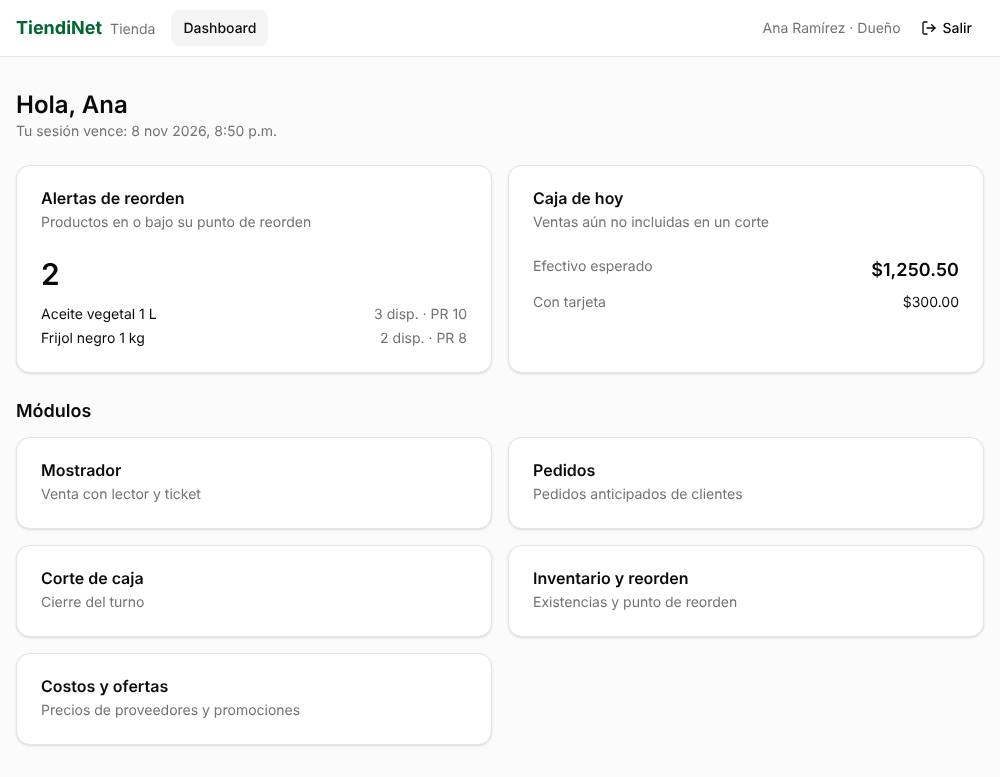

# Login y ruta protegida — TiendiNet

| Campo | Valor |
|---|---|
| Portal | Portal Tienda (`/tienda/`), roles Dueño y Empleado |
| Archivos | `src/pages/tienda/LoginPage.tsx`, `src/components/RutaProtegida.tsx`, `src/pages/tienda/DashboardPage.tsx`, `src/services/authService.ts`, `src/main-tienda.tsx` |
| Pruebas | `src/pages/tienda/flujoLogin.test.tsx` (9 pruebas) |
| Fecha | 8 de noviembre de 2026 |

## Rutas

| Ruta | Acceso | Qué muestra |
|---|---|---|
| `/tienda/login` | Pública | Formulario de inicio de sesión |
| `/tienda/dashboard` | Protegida (Dueño y Empleado) | Saludo, alertas de reorden, caja del día y módulos según el rol |
| `/tienda/` | Protegida | Redirige al dashboard |

## Flujo

1. **Ruta protegida sin sesión.** `RutaProtegida` revisa tres cosas: que haya usuario, que la sesión no haya vencido (`expiraEn`) y que el rol esté permitido. Si falta alguna, redirige a `/login` y guarda la página pedida en el estado de navegación (`desde`).
2. **Formulario.** `LoginPage` valida el correo (formato) y la contraseña (obligatoria) antes de llamar a la API. Con errores, lleva el foco al primer campo inválido.
3. **Llamada al servicio.** El hook `useIniciarSesion` llama a **`authService.login()`** (`POST /auth/sesiones`). Si el rol de la cuenta es Cliente, la rechaza con "Esta cuenta no tiene acceso a este portal." y no guarda nada.
4. **Almacenamiento del token.** La respuesta trae `token`, `expiraEn` y `usuario`. El store de sesión los guarda en memoria y en `sessionStorage`, con la clave `tiendinet-sesion-tienda`. El motivo de usar `sessionStorage` está en `capa_servicios.md`.
5. **Redirección.** Con la sesión guardada, `LoginPage` redirige a la página pedida en el paso 1 o, si no hubo ninguna, a `/dashboard`.
6. **Dashboard.** Consume la API con el JWT, que agrega el interceptor de autenticación: `GET /alertas` y `GET /cortes-caja/vista-previa`. `RutaProtegida` además confirma la cuenta con `GET /auth/yo`; si el Dueño la desactivó, la sesión se cierra y regresa al login (RF-03-AC-2).
7. **Salir.** `authService.logout()` borra la sesión y la caché, y la ruta protegida vuelve a pedir el login.

Los errores del login (credenciales incorrectas, bloqueo por intentos, sin conexión) llegan con el mensaje ya preparado por la capa de servicios y se muestran en el formulario.

## Resultados de la prueba

### Pruebas automáticas (`npm test`)

| Prueba | Resultado |
|---|---|
| Sin sesión, `/dashboard` redirige al login | ✓ |
| Con la sesión vencida, redirige al login | ✓ |
| Inicia sesión → token en el store y en `sessionStorage` → dashboard con datos de la API, peticiones con `Bearer` | ✓ |
| Después del login regresa a la página pedida (`/dashboard?vista=caja`) | ✓ |
| El Empleado no ve "Costos y ofertas" ni "Inventario y reorden" (RF-01-AC-3) | ✓ |
| Credenciales incorrectas: mensaje de la API y sin sesión | ✓ |
| Una cuenta de Cliente no entra al Portal Tienda | ✓ |
| Formulario vacío: errores, foco en el correo y ninguna llamada a la API | ✓ |
| Salir: vuelve al login y borra el token | ✓ |

Todo el proyecto suma 39 pruebas en verde.

### En Chrome, contra una API simulada con la forma del contrato

| Paso | Resultado |
|---|---|
| 1. Abrir `/tienda/dashboard` sin sesión | Redirige a `/tienda/login` |
| 2. Iniciar sesión como Dueño | Llega a `/tienda/dashboard` con "Hola, Ana", 2 alertas y $1,250.50 en caja |
| Peticiones a la API | `POST /auth/sesiones` sin token; `GET /alertas`, `GET /cortes-caja/vista-previa` y `GET /auth/yo` con `Bearer tok-dueno` |
| Almacenamiento | Token y expiración en `sessionStorage`; `localStorage` vacío |
| 3. Recargar la página | Sigue en el dashboard |
| 4. Abrir el dashboard en otra pestaña | Pide login: `sessionStorage` es por pestaña |
| 5. Salir | Regresa al login, token borrado; volver a `/tienda/dashboard` redirige al login |
| 6. Empleado en móvil (375 px) | Dashboard en una columna, sin los módulos del Dueño |
| Errores de JavaScript | Ninguno |
| Accesibilidad (axe-core, 1000 px y 375 px) | Sin violaciones |

## Decisión a revisar con el equipo

Como el token vive en `sessionStorage`, **cada pestaña nueva pide iniciar sesión**. En el mostrador eso protege la computadora compartida. Si el equipo prefiere que el Dueño abra varias pestañas sin volver a entrar, el cambio está en `src/stores/sesion.ts`: usar `localStorage` solo en el Portal Tienda. El costo es que la sesión sobrevive al cierre del navegador hasta que expire (60 min).
